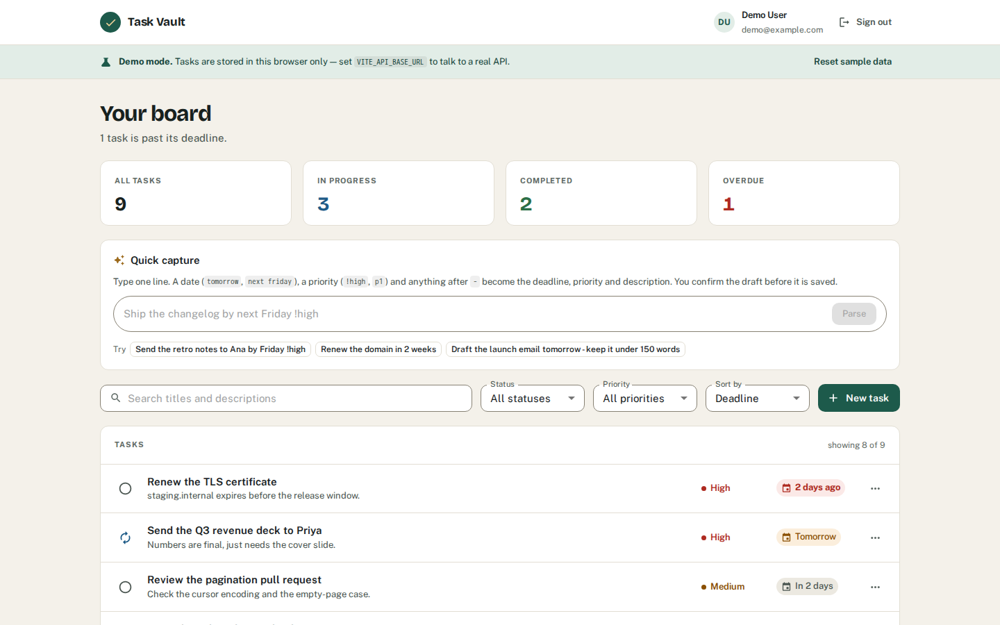
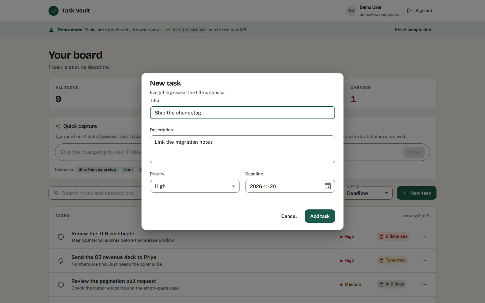
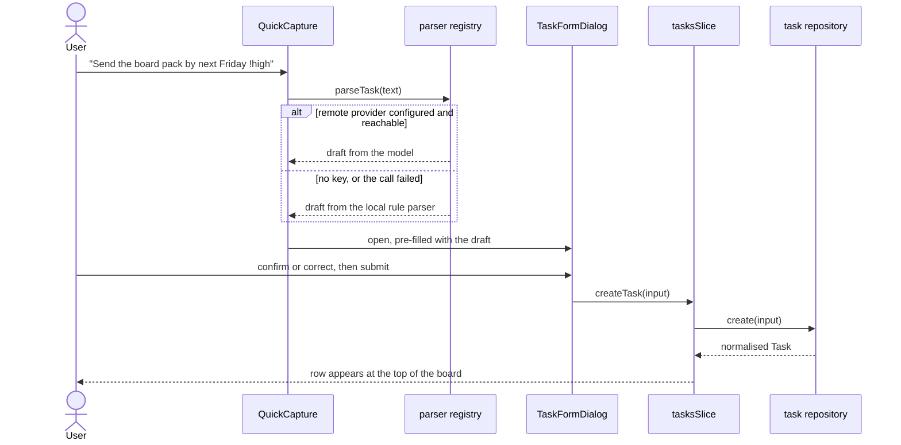
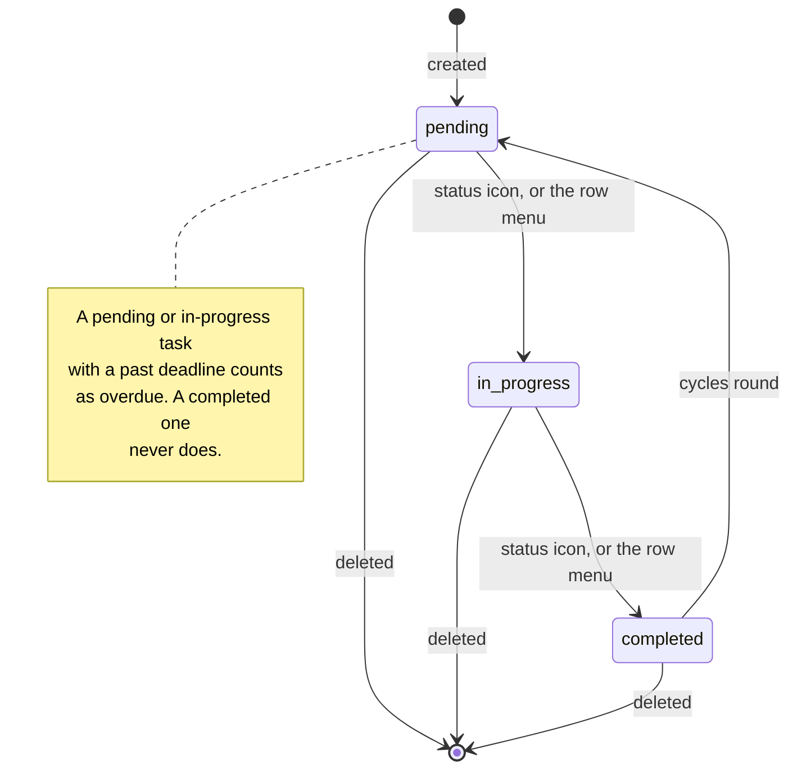
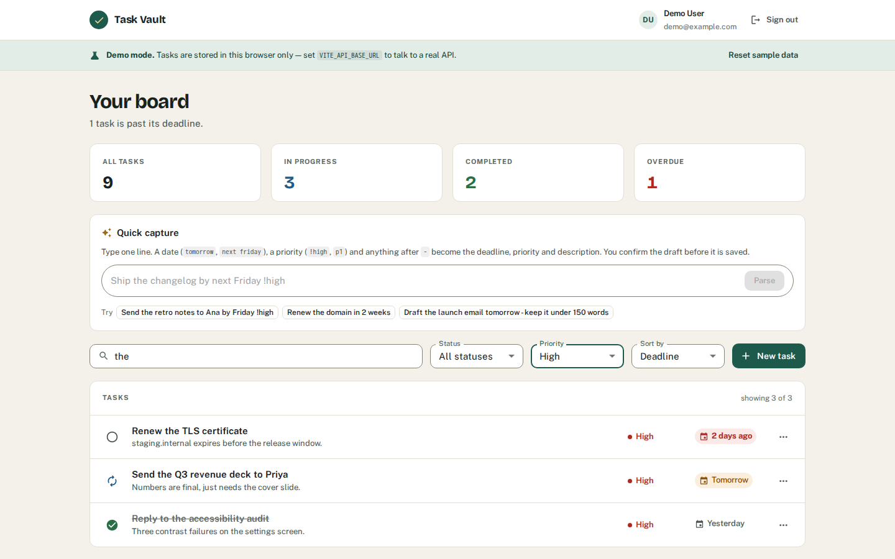
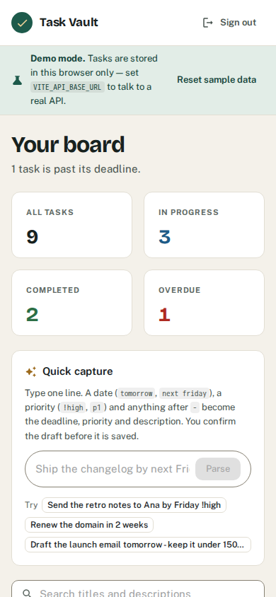
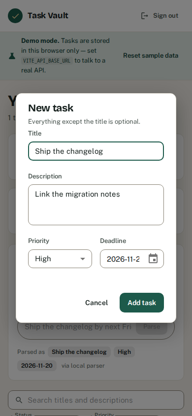
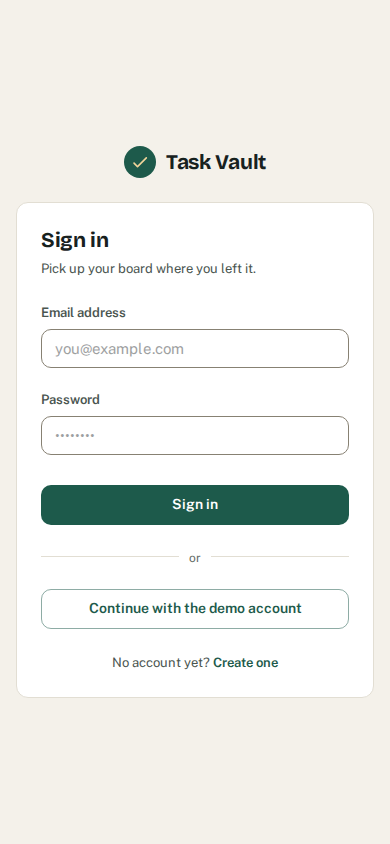
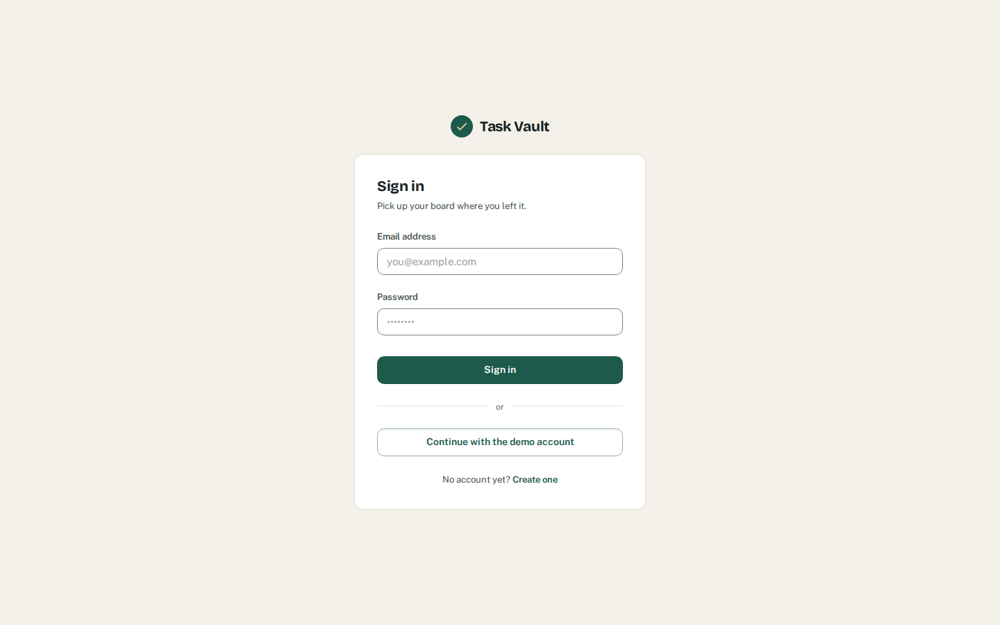

# Task Vault

A React task board: filterable, sortable, paginated, and able to turn a line of
plain English into a task. It runs with no backend: clone it, `npm start`, and
you get a seeded board straight away. Point it at the companion Rails API and
the same screens read and write real tasks.



## Running it

You need Node 22.22 or later (`.nvmrc` pins 22) or Docker.

```bash
npm ci
npm start          # http://localhost:3000; PORT=4000 npm start to move it
```

Or, with nothing but Docker:

```bash
docker compose up --build          # http://localhost:7131
```

`VITE_API_BASE_URL` is empty in `.env.example`, and an empty base URL turns on
**demo mode**: the app swaps its HTTP repositories for in-browser ones backed by
`localStorage` and seeds nine tasks with deadlines relative to today. Nothing
runs alongside it. A banner says so, and **Reset sample data** puts the seed
back after you have played with it.

The demo repository is a real implementation of the same contract the HTTP one
satisfies, not a stub, which is why the test suite can exercise it directly.

## Turning a sentence into a task

Typing into **Quick capture** pulls a title, a priority and a deadline out of
one line and opens the task form pre-filled. It never writes a task on its own;
you confirm or correct the draft first. The syntax is spelled out right under
the heading, and that hint is also the input's accessible description.



| You type                                                    | Title                  | Priority | Deadline                  |
| ----------------------------------------------------------- | ---------------------- | -------- | ------------------------- |
| `Ship the changelog by next Friday !high`                   | Ship the changelog     | high     | the Friday after this one |
| `Renew the domain in 2 weeks`                               | Renew the domain       | medium   | today + 14 days           |
| `Patch the auth bug p1`                                     | Patch the auth bug     | high     | none                      |
| `urgent call with legal`                                    | Call with legal        | high     | none                      |
| `Draft the launch email tomorrow - keep it under 150 words` | Draft the launch email | medium   | tomorrow                  |

Dates it understands: `today`, `tomorrow`, `next week`, `end of month`,
`in N days` / `in N weeks`, a bare or `next` weekday, `YYYY-MM-DD`, and
`<month> <day>`. Priority comes from `!high` / `!medium` / `!low`, `p1` / `p2` /
`p3`, or words like _urgent_ and _someday_. Anything after `-` becomes the
description. Two parsers are registered in `src/services/ai/index.js`:

- **`local`**: the rule parser above. Deterministic, offline, no credentials,
  and unit-tested against a fixed clock in `localTaskParser.test.js`.
- **`remote`**: an OpenAI-compatible chat-completions endpoint. It reports
  itself unavailable unless both `VITE_AI_ENDPOINT` and `VITE_AI_API_KEY` are
  set.

`parseWithProvider` falls back to `local` whenever the named provider is
unknown, unavailable, or throws, and the model's reply is run through
`coerceRemoteResult` before it is trusted: a missing title, an invented
priority or a non-ISO date is discarded rather than shown to the user. The
quick-capture control therefore behaves identically with and without a key, and
there is no failure path that leaves the form empty.

## Where a task comes from



## The task repository contract

Every read and write goes through one interface, documented in
`src/services/tasks/taskRepository.js`:

```
list()                   -> Promise<Task[]>
get(id)                  -> Promise<Task>
create(input)            -> Promise<Task>
update(id, input)        -> Promise<Task>
updateStatus(id, status) -> Promise<Task>
remove(id)               -> Promise<void>
```

Two implementations ship. `apiTaskRepository` talks to the Rails API, which
wraps records as `{ id, type, attributes: { … } }`, returns statuses as its enum
keys (`pending`, `In progress`, `completed`) and accepts them as the integers
`0` / `1` / `2`. `demoTaskRepository` keeps flat rows in `localStorage`. Both
resolve to the same normalised `Task` shape in `src/domain/task.js`, so no
component and no reducer knows which one is in play. `resolveTaskRepository()`
picks one from config and `setTaskRepository()` injects a stub in tests.
`assertTaskRepository` fails loudly, naming the missing methods, if a third
implementation is incomplete.

Deadlines are calendar days (`YYYY-MM-DD`), not instants. `src/domain/day.js`
reads and writes them as local dates, so a task due today is "Today" in
Lisbon and in Los Angeles alike, and relative dates survive a DST change.

## Task states



Clicking the icon at the left of a row advances it one step; screen readers
hear the task, its status and the next step ("Renew the TLS certificate:
pending. Mark as in progress"). The overflow menu jumps to any other status.
Completed tasks sort below unfinished ones in every ordering, so finished work
never sits at the top of the board.

## Finding things



Search matches titles and descriptions, and combines with the status and
priority filters and a sort key. Filtering and sorting live in
`src/domain/taskQuery.js` as pure functions and are wrapped in `createSelector`,
so they run once per `(tasks, query)` pair rather than on every keystroke of
every row. The list pages at `VITE_PAGE_SIZE` rows (8 by default); `paginate()`
clamps an out-of-range page instead of rendering an empty one, and changing any
filter returns you to page one.

Paging is client-side because the API returns every task in one response, and is
confined to one function so moving it server-side is a change in one place.

On a phone the priority column folds away and the deadline moves under the
title, so an overdue task still looks overdue:

<p>
  
  
  
</p>

## Signing in



With an API configured, `/login` and `/sign-up` post to it and the token from
the response's `Authorization` header is stored and attached by an axios request
interceptor. A 401 or 403 on any request clears the token once, in one response
interceptor, and dispatches `sessionExpired()`, which empties the session and
the board.

In demo mode there is no server to authenticate against, so `ProtectedRoute`
opens a demo session itself rather than bouncing a first-time visitor to a form
that would accept anything. **Sign out** is respected: it lands on `/login`,
which offers the demo account again, instead of signing you straight back in.

Only the user and token are persisted (redux-persist, key
`task-vault:auth`). Request status is not, so a reload in the middle of a
sign-in can never leave the form stuck on "Please wait".

## Talking to a real API

```bash
cp .env.example .env
# VITE_API_BASE_URL=https://your-task-api.example.com
npm start
```

The client expects `POST /login`, `POST /sign_up`, `DELETE /logout` and
`/api/v1/tasks` with the usual five verbs, as served by the Rails backend
(to_do_app_backend). Because the API sits on another origin, it has to allow
this origin and expose the `Authorization` response header through CORS, or
the browser hides the session token from the client.

Vite inlines `VITE_*` values **at build time**, so changing the base URL means a
rebuild, not a restart, which is why the Docker image takes it as a build
argument. Everything configurable is read once in `src/config/index.js`; no
component reaches into `import.meta.env`. The same inlining means
`VITE_AI_API_KEY` is readable by anyone who loads the page, so only use a key
that is meant to be public, such as one issued by your own rate-limited proxy.

`src/mocks/taskApi.js` is an [MSW](https://mswjs.io/) mock of that backend,
written from its controllers and serializers: the JSON:API envelopes, the
`In progress` enum key, its validations and `422 { errors }`, Devise's 401, and
the CORS headers. The tests run the whole app against it, so the API path is
covered without a Rails process. Captured from the mock, a status change looks
like this:

```http
PATCH /api/v1/tasks/2
Authorization: Bearer <token>
Content-Type: application/json

{"task":{"status":1}}
```

```json
{
  "data": {
    "id": "2",
    "type": "task",
    "attributes": {
      "id": 2,
      "title": "Order new desk chairs",
      "description": "Two for the design corner.",
      "status": "In progress",
      "priority": "low",
      "deadline": "2030-03-20"
    }
  }
}
```

and a rejected save:

```json
HTTP/1.1 422
{"errors":["Description can't be blank","Deadline can't be blank"]}
```

which the board shows as a toast: "Description can't be blank, Deadline can't
be blank".

## How the source is arranged

```
src/
  config/      every environment-dependent value, resolved once
  domain/      task vocabulary, calendar days, filtering, sorting, paging — pure
  services/
    http/      one axios instance, its interceptors and error flattening
    tasks/     the repository contract and its two implementations
    auth/      sign-in, sign-up, sign-out against API or demo
    ai/        the parser registry, the local rule parser, the remote provider
  store/       Redux Toolkit slices, thunks and memoised selectors
  modules/     the two screens: Tasks and Authorization
  components/  page chrome and the shared, presentational pieces
  routes/      route table and the auth guard
  theme/       the single palette, type scale and component overrides
  mocks/       the MSW mock of the Rails API, used by the tests only
```

Dependencies point one way: `domain/` imports nothing outside itself,
`services/` imports `domain/` and `config/`, `store/` imports `services/`, and
only the UI layers (`modules/`, `components/`, `routes/`) import React. Files import each other from the
`src/` root (`import config from "config"`), resolved by a small plugin in
`vite.config.js` and described to editors by `jsconfig.json`.

Each screen is its own chunk: the sign-in page, the board and the 404 page load
on demand, and the task form, which carries the date picker and date-fns, loads
the first time a task is opened. The largest chunk is about 220 kB minified.

## Look and feel

A vault is paper, ledger green and brass: a warm paper canvas, deep pine for
anything you can act on, brass on the mark and the quick-capture spark.
Headings and figures use Bricolage Grotesque and body text Public Sans, loaded
from Google Fonts with the system stack as fallback. Every text colour clears
WCAG AA (4.5:1) on its background, form outlines clear 3:1, and keyboard focus
always draws a ring. The palette lives in `src/theme/index.js` and components
only use its tokens.

## Tests and checks

```bash
npm test            # Vitest, watch mode
npm run test:ci     # single run
npm run lint        # ESLint 9, fails on any warning
npm run format:check
npm run build       # production bundle in dist/
```

123 tests across 18 files cover:

- the pure domain functions and calendar-day handling;
- the natural-language parser against a fixed clock;
- the demo repository's CRUD and persistence, and the repository-contract
  assertion;
- both Redux slices with a stubbed repository, and session persistence;
- the HTTP repository and its error handling against the MSW mock;
- the route guard in demo mode, and Quick capture;
- the task list's loading, empty, filtered-empty, error and populated states;
- one test that drives the whole app through the mock API: sign in, the
  board, quick capture to a saved task, and sign out.

Vitest runs the suite in `America/Los_Angeles`, so a date parsed as UTC fails
on every machine, not only for users west of Greenwich.

## Docker

Multi-stage: `node:22-alpine` builds, `nginx:1.30-alpine` serves. The runtime
stage runs as the `nginx` user and listens on 8080, because a non-root process
cannot bind below 1024. The compose service adds `read_only: true`,
`no-new-privileges` and a single tmpfs at `/tmp`, where nginx keeps its pid and
temp files; logs go to stdout and stderr.

```bash
docker compose up --build          # http://localhost:7131
WEB_PORT=8000 docker compose up    # somewhere else
```

With no `VITE_API_BASE_URL` in the environment the image is built in demo mode.
To bake in a real API:

```bash
VITE_API_BASE_URL=https://your-task-api.example.com docker compose up --build
```

`nginx.conf` caches the hashed bundles under `/assets/` for a year, serves
`index.html` with `no-store`, and falls back to it so `/login` and `/sign-up`
survive a refresh.

## Known limits

- **The token lives in `localStorage`.** That is what the API's `Authorization`
  header flow assumes, and it is readable by any script on the page. An
  httpOnly cookie would be the fix, and it needs a server change.
- **The form is looser than the API.** The Rails model requires a description
  and a deadline and caps titles at 30 characters; the form treats both as
  optional and allows 120. Against the API, such a save is rejected and the
  API's message is shown in a toast; demo mode accepts it.
- **Filtering, sorting and paging happen in the browser.** Fine for a personal
  board, wrong at ten thousand tasks. `taskQuery.js` and `paginate()` are the
  two places that would move server-side.
- **Mutations are not optimistic.** Each one waits for the repository before the
  row changes, so a slow API shows a visible delay.
- **Demo mode is not authentication.** It accepts any well-formed credentials
  because there is nothing to check them against.
- **React 18 and MUI 5.** Moving to React 19 means MUI X date pickers 7 or later
  first; nothing here needs it yet.

## License

MIT, see [LICENSE](LICENSE).
